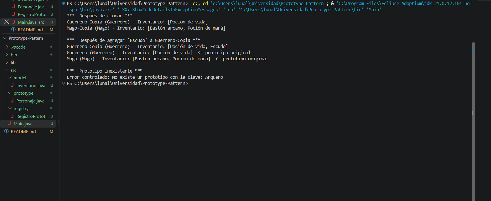

# Video Game Character Generator
> Introduction to the Creational: Prototype Design Pattern

## Description
A small application of the **Prototype design pattern** to quickly create video game characters by cloning pre-configured base characters (prototypes) instead of building each one from scratch.

### Why use Prototype Pattern in this case?
Prototype is a creational design pattern that lets you copy existing objects without making your code dependent on their classes. 
So, it is perfect in this case, because the studio needs to generate variations of base characters (name, class, weapon and inventory) without repeating their whole construction, and the client code (`Main`) only asks the registry for a copy.

It also shows the difference between a **shallow copy** and a **deep copy**: `Personaje.clonar()` copies the character with `super.clone()` and then replaces its `Inventario` with an independent copy, so modifying the inventory of a clone never alters the original prototype.

## Project Structure

```
src/
├── model/
│   └── Inventario.java
├── prototype/
│   └── Personaje.java
├── registry/
│   └── RegistroPrototipos.java
└── Main.java
```

## How to Run
Requirements: JDK 8 or higher.

From the project root:

```bash
# Compile
javac -d out src/model/*.java src/prototype/*.java src/registry/*.java src/main/*.java

# Run
java -cp out main.Main
```

## Console Output
